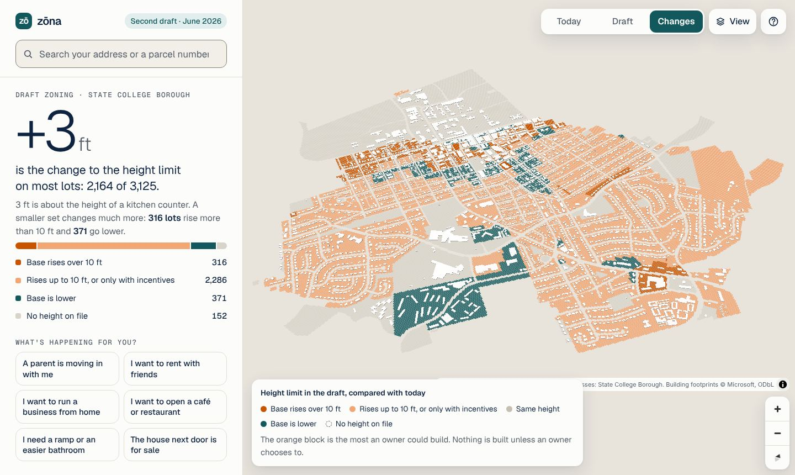
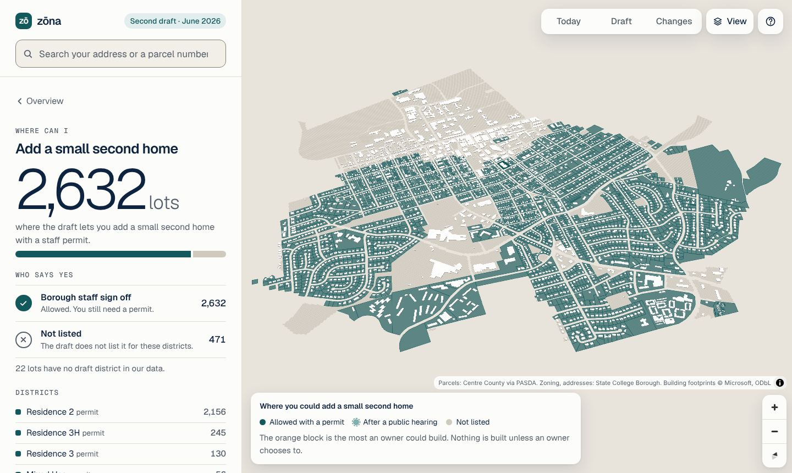
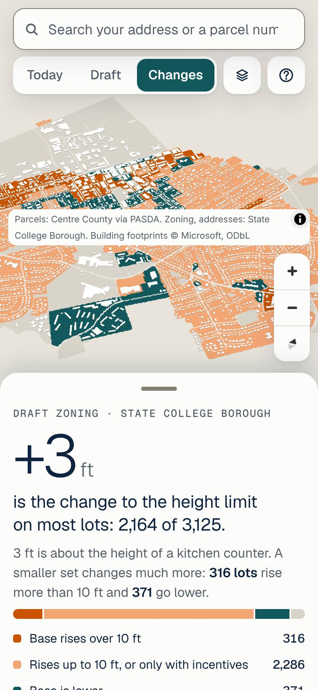

<div align="center">

# zōna

**What does the new zoning mean for my lot?**

A plain-language 3D zoning map that any town, borough or city can run.

[**See the demo**](https://zona-zeta.vercel.app) · [Report a wrong answer](../../issues/new?template=correction.md) · [Data sources](DATA.md)

[](LICENSE)
[](DATA.md)


<picture>
  <source media="(prefers-color-scheme: dark)" srcset="docs/overview-dark.jpg">
  
</picture>

</div>

## Why this exists

When a town rewrites its zoning, the draft usually runs hundreds of pages across PDFs, use tables and a district map. Most residents only want to know a few things: what changes on my street, can I do the thing I'm planning, and who decides.

zōna starts from those questions, not from the ordinance's structure. It answers in plain words, shows the answer on a map, and cites the section it came from.

## What it does

- **Shows the typical change.** It leads with the change most lots see, for example "+3 ft, about the height of a kitchen counter", and highlights the smaller set of lots that change a lot more.
- **Starts from your life, not the code.** Residents pick "A parent is moving in with me" or "I want to open a café", and zōna turns that into the zoning question underneath it.
- **Answers "Where can I…" with real counts.** For example, "Add a small second home: 2,632 lots", split by who says yes.
- **Says who decides.** Every answer is one of four: *Yes* (staff issue a permit), *Yes, after a hearing* (a hearing board or the governing body), *No*, or *Not decided yet*.
- **Explains any lot.** Search an address or parcel number to see today's and the draft's height limits, a summary of the block, and what you could do there.
- **Points to the process.** It gives the draft timeline and how to send a public comment.
- **Works on phones.** The map comes with a bottom sheet you can drag to any height. Phones open in light mode.

<table>
<tr>
<td width="62%"></td>
<td width="38%"></td>
</tr>
</table>

The screenshots and demo use the sample data that ships in `app/data/`: one Pennsylvania borough's second zoning draft from June 2026. See [DATA.md](DATA.md).

## Run it locally

There's nothing to install. It's one HTML page plus a few JSON files, so any static server works.

```sh
git clone https://github.com/nishbarot/zonamaps.git
cd zonamaps/app
python3 -m http.server 8000
# open http://localhost:8000/simple.html
```

The page loads [MapLibre GL JS](https://maplibre.org) 4.7.1 from cdnjs. A copy is also kept in `app/vendor/` in case you need to work offline.

## How it works

```
app/
  simple.tpl.html   the explorer: layout, styles, page logic (edit this)
  page.src.html     older console page; shared pieces are copied from it
  build_simple.py   builds simple.html from the two files above
  simple.html       the built page that gets served (don't edit by hand)
  data/
    parcels.json    lots: shape, today's and draft district, height limits
    rules.json      today's and draft rules per district (uses, heights, parking)
    addresses.json  parcel number -> street address
    buildings.json  building footprints (Microsoft, ODbL)
  vercel.json       serves simple.html at /
tools/
  screenshots.js    Playwright screenshots at laptop, tablet and phone sizes
  get_footprints.py cuts building footprints for your area from a statewide file
```

- **No framework and no backend.** The page fetches four JSON files and draws them with MapLibre. Everything else, including counts, block summaries and answers, is computed in the browser.
- **Colors are tokens.** Light and dark palettes sit at the top of `simple.tpl.html`. Orange only ever means "changes".
- **Rebuild after you edit:**

  ```sh
  cd app && python3 build_simple.py   # writes simple.src.html and simple.html
  ```

  `build_simple.py` copies some shared code out of `page.src.html` by line range. If you move code in that file, update the line numbers, and the script's checks will tell you if a piece is missing.

## Set it up for your town

1. **Parcels.** Export your county's or town's parcels as GeoJSON polygons into `data/parcels.json`. Each feature needs an `id` (parcel number), `cur` and `draft` district codes, and the height limits `h_cur`, `h_draft` and `h_draft_max` in feet. A lot with no height on file can leave them `null`.
2. **Rules.** In `data/rules.json`, describe each district under `current` and `draft`: a `name`, `ft`, `stories`, and a `use` map whose values are `"P"` (permitted), `"S"` (special exception), `"C"` (conditional use) or `null` (not listed), plus optional `parking` and `incentives`.
3. **Addresses.** Map parcel numbers to site addresses in `data/addresses.json`. Use parcel number and address only. Leave out owner names and sale data.
4. **Footprints (optional).** Run `tools/get_footprints.py` on your state's file from [Microsoft's footprints](https://github.com/microsoft/USBuildingFootprints) and keep the ODbL credit.
5. **Words and links.** Your town's questions, life events, timeline, comment email, source links, map credits and footer are constants in `simple.tpl.html` (`USEQ`, `EVENTS`, `CATCH`, `SRC`, `FOOT`, and the `customAttribution` line). Rewrite them for your ordinance and cite your own sections.
6. **Credit your sources** in your own `DATA.md`.

If you set one up, open an issue and tell us about it.

## Contributing

Corrections matter most. If an answer is wrong for a lot, [open a correction](../../issues/new?template=correction.md) with the parcel number and the ordinance section that says otherwise.

Code changes are welcome too. See [CONTRIBUTING.md](CONTRIBUTING.md) for how to run, check and screenshot your change, and for the writing rules every answer follows:

- Verified facts only, and label any guess.
- Never call a draft "official", and never call a traced district map the government's own GIS.
- Use made-up examples ("123 Main Street", "Jane Doe"), never real people or real addresses.

## Limits

- A draft ordinance is **not law** and can change before adoption. The page shows the draft's date.
- District lines traced by hand from a PDF map are approximate, and zōna says so.
- Setbacks, lot coverage, density and overlays are not applied yet.
- **Nothing here is legal advice.** The local planning and zoning office decides what applies to a lot.

zōna is an independent, nonpartisan project. It is not made by or for any government.

## License and credits

- **Code:** [MIT](LICENSE).
- **Data:** keeps its own terms, listed source by source in [DATA.md](DATA.md). Building footprints are © Microsoft under the ODbL.
- **Map:** [MapLibre GL JS](https://github.com/maplibre/maplibre-gl-js) (BSD-3-Clause).

Built by Nish Barot.
