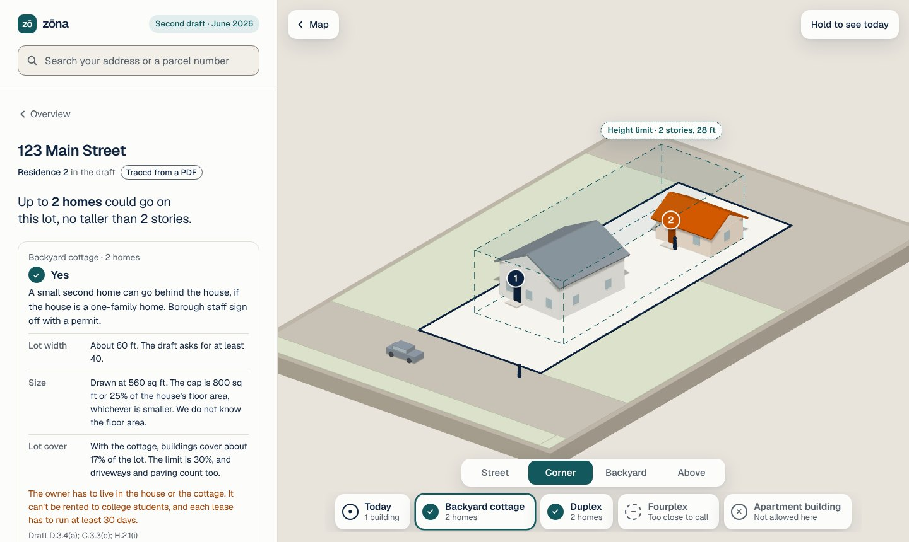

# The lot view: system design

The lot view answers one question for one lot: **how many homes could go here, and what would that look like?** A resident opens their lot and sees it as a small 3D model. They tap "Backyard cottage", "Duplex" or "Fourplex" and the model changes, with a plain answer and the draft section beside it.

This note records how it is built, what it assumes, and what to change as zōna grows. The sample numbers come from the data in `app/data/` (see [DATA.md](../DATA.md)).



## 1. Requirements

### What it does

- Draws the lot a person opened, with its real shape, today's buildings and the neighbors around it.
- Offers the housing types the draft lists for that district, each as one tap: Today, Backyard cottage, House (empty lots only), Duplex, Fourplex, Apartment building.
- Gives each type one of zōna's existing answers: **Yes**, **Yes, after a hearing**, **No**, or a dashed "we can't tell" with the reason.
- Shows the rule as a shape: a dashed teal frame for where a new building may stand and how tall it may be.
- Counts homes as numbered front doors. There is no money, floor area ratio or unit yield anywhere.
- Lets people compare with "Hold to see today" and four fixed views (Street, Corner, Backyard, Above).

### What it must hold to

| Need | Target |
|---|---|
| Honest | Never draw an answer the data cannot support. County lot lines are rounded to about 1 m, so anything within 5 ft of a width limit or 3% of a size limit is "too close to call". |
| Light | The home page must not get heavier. The 3D code loads only when a lot with a model is opened. |
| Works everywhere | Phone first. If WebGL or the 3D library is missing, a flat plan of the same lot takes its place. |
| Simple | One tap per choice, 44 px targets, no free camera to get lost in. |
| No backend | Static files only, like the rest of zōna. All geometry runs in the browser. |
| Portable | Another town turns it on by adding numbers to `rules.json`. No town words in the code. |

### Constraints

- No build step beyond `build_simple.py`, no framework, no server.
- The data has lot shapes and building outlines only. There are no street centerlines, building heights, driveways or unit counts.
- The draft is not law. Every number is cited and every guess is labelled.

## 2. High-level design

```
                    loaded with the page                     loaded when a lot opens
              +----------------------------+            +-----------------------------+
 parcels.json |                            |            |                             |
 buildings.json --> lotmath.js  (geometry) |            |  three.js r128 (cdnjs)      |
 rules.json   |      index(), analyse()    |            |  lot3d.js  (drawing only)   |
              |            |               |            |      mount(), setModel(),   |
              |            v               |   model    |      pick(), view(), peek() |
              |     the lot model  --------+----------->|                             |
              |            |               |            +-----------------------------+
              |            v               |
              |  page script in            |
              |  simple.tpl.html:          |
              |  words, choice tray,       |
              |  flat SVG plan (fallback)  |
              +----------------------------+
```

Three parts, each with one job:

| Part | File | Job | Knows about |
|---|---|---|---|
| Lot math | `app/lotmath.js` | Turns one parcel into a **lot model**: which side faces the street, the yard lines, what fits. Pure functions, no DOM. Also runs in Node. | Geometry and the numbers in `rules.json` |
| Page script | `app/simple.tpl.html` | Writes the sentences, the choice tray and the flat plan. Decides when the lot view is open. | The lot model, `town.js` wording |
| 3D drawing | `app/lot3d.js` + three.js | Draws the model and animates between choices. Makes no decisions. | The lot model only |

**Data flow for one tap on a lot**

1. `select(id)` asks `lotModel(id)`, which calls `ZonaLot.analyse(index, id, rules.draft[district].lot)`. The result is cached for the open lot.
2. If the model is `ok`, the lot view opens over the map. The page script fills the tray, the answer card and the flat plan straight away.
3. The first time, the page fetches three.js and then `lot3d.js`. When they arrive the flat plan is swapped for the 3D canvas.
4. Tapping a choice calls `lvPick(k)`: the answer card, the plan and the 3D model all follow `state.pick`.
5. If the model is not `ok`, the lot keeps today's page and one line says why ("This lot has an irregular shape, so it has no lot model yet.").

## 3. Deep dive

### The rules block

A district gets a lot view when its draft entry in `rules.json` has a `lot` block. Only numbers and citations live there:

```json
"lot": {
  "cite": "Draft C.3.3(c)", "max_acres": 1,
  "height": {"ft": 28, "stories": 2},
  "rear": {"pct_depth": 15, "min_ft": 10}, "max_depth_ft": 50,
  "types": {
    "house":    {"width_ft": 40, "front_ft": 25, "side_ft": 8, "cover_pct": 30, "parking": 1},
    "duplex":   {"width_ft": 40, "front_ft": 25, "side_ft": 8, "cover_pct": 30, "parking": 4},
    "fourplex": {"width_ft": 40, "area_sqft": 10000, "cover_pct": 40, "parking": 4, "catch": "...", "cite": "..."},
    "adu":      {"sep_ft": 10, "max_sqft": 800, "max_share_pct": 25, "catch": "...", "cite": "Draft D.3.4(a)"}
  },
  "not_here": ["apartments"],
  "cites": {"yards": "...", "rear": "...", "width": "...", "block": "...", "cover": "...", "parking": "...", "corner": "..."}
}
```

The sample data fills this in for Residence 2 only, read from the Borough's second draft (June 2026; its pages are headed "Public Hearing Draft"): Table C.3.3(c) and its notes, D.3.4(a) for accessory dwelling units, Table E.1.6(a) for parking, and H.2.1 and H.3 for how lots are measured.

### The lot model

`analyse()` returns either `{ok:false, why, text}` or:

```
{ ok, id,
  lot      the lot outline, in metres, street side at the bottom
  sides    [{a, b, len, kind: lot|alley|street|open, role: front|side|rear, set_ft}]
  build    the outline a new building must stay inside (the lot minus its yards)
  bld      today's building outlines, largest first
  ped, around, aroundB    the patch of ground drawn, with neighbor lots and buildings
  width_ft, depth_ft, sqft, acres, set:{front_ft, side_ft, rear_ft}
  corner, through, outside, height_ft, stories
  choices  [{k, state: now|may|no|nd, homes, checks, ex, sqft, cover, cover_max, park, tight, full}]
  most     the largest number of homes any "may" choice gives
}
```

`ex` is the example building: a rectangle placed inside `build`. `checks` holds each test with what the lot has and what the draft asks for, so the page can write the sentence without redoing any math.

### Finding the street with no street map

The data has no streets. Lots tile a block, so whatever lies past a lot line tells us what that line faces. For each side, `lotmath.js` walks outward from three points on it:

| Found within | The side faces |
|---|---|
| 2.5 m, another lot | a neighbor |
| 10 m, another lot | an alley |
| 32.5 m, another lot | a street |
| nothing | open land or the edge of the data |

Street sides that point the same way are grouped into a frontage. One frontage is the front. With two or more, the shorter one is the front (a corner lot's narrow end), unless they are within 15% of each other, when the one nearest the main building wins. Clipped corners under 6 m are never the front. Corner lots give every street side the front yard distance, and through lots get a front yard at both ends, as the draft says in H.2.1(d).

If no side faces a street, the lot gets no model.

### Yards, width and what fits

- **Yards.** Each side is moved inward by its distance: front 25 ft, sides 8 ft, rear 15% of the lot's depth or 10 ft, whichever is greater. What is left is `build`.
- **Lot width** is measured where the draft measures it: at the front yard line, and held for 30 ft behind it (H.2.1(c)).
- **Example buildings** are plain rectangles placed at the front of `build`, sized like an ordinary building of that type (a duplex up to 48 ft wide, a fourplex up to 60 ft), no deeper than 50 ft, and kept to 80% of the lot cover limit so there is room left for a driveway.
- **Backyard cottage.** Scanned from the back of the lot: inside `build`, 10 ft from the house, not in front of it, clear of other buildings. Its size is capped at 800 sq ft or 25% of the house's floor area. We do not know floor area, so the drawing assumes the house has two floors and says so.
- **Lot cover** adds building footprints only. The draft also counts driveways and paving, and the card says that.

### Answers and precision

| State | Shown as | When |
|---|---|---|
| `may` | Yes, orange building, numbered doors | Every check clears its limit with room to spare |
| `no` | No, grey outline | The lot is clearly under a size limit, or the draft does not list the use |
| `nd` | Dashed "can't tell", grey outline, the reason in words | A check is too close to call, the lot is narrower than the draft asks (the block average may still allow it, H.3.2), there is no clear spot, or the lot may be too full |

Width within 5 ft of the limit and size within 3% are too close to call. This is the main honesty rule: the model would rather say "check with the Borough" than flip a household's answer on a rounding error.

### Drawing

- An orthographic camera with four named views. A sideways drag turns the model and snaps to the nearest view, so nobody ends up under the ground.
- The camera fits itself to the lot and leaves room for the floating buttons, at any screen size.
- White is today, orange is change (the same meaning orange has everywhere in zōna), dashed teal is the rule, grey is "not here".
- Labels are HTML placed over the canvas: door numbers, the height limit, yard distances in the Above view. Screen readers get the choice and its answer on the canvas label, and the full answer is ordinary text in the panel.
- Rendering is on demand. A still model costs nothing.
- People who ask for reduced motion get instant changes and no autoplay.

### Loading and fallback

| Situation | What the person sees |
|---|---|
| Home page, any tab | No 3D code is fetched. `lotmath.js` is 18 KB. |
| First lot with a model | The flat plan at once, then the 3D model once three.js (604 KB, about 121 KB compressed) and `lot3d.js` (19 KB) arrive. |
| Later lots | 3D straight away. |
| No WebGL, or the CDN is blocked | The flat plan stays. Every choice and answer still works. |
| Lot with no model | Today's lot page, with one line saying why. |
| District with no `lot` block | Today's lot page, unchanged. |

## 4. Scale and reliability

Measured on the sample data with `node tools/check_lots.js`:

| | |
|---|---|
| Lots | 3,125 |
| Lots in a district with lot rules | 2,156 |
| Lots that get a model | **1,750** (81%) |
| No model: irregular shape | 251 |
| No model: no street side found | 108 |
| No model: too small or over 1 acre | 44 |
| No model: condo units | 3 |
| Corner lots / through lots | 311 / 12 |
| Building the index | about 25 ms, once per page load |
| One lot | well under 1 ms (all 2,156 take about 0.4 s) |

Each lot is worked out when it is opened, so cost does not grow with town size. A town with 50,000 lots would spend more on downloading `parcels.json` than on any of this. The index is a 60 m grid, so neighbor lookups stay constant time.

**What can go wrong, and what catches it**

| Failure | Guard |
|---|---|
| A change to the math puts an example building outside the yard lines | `tools/check_lots.js` checks every example on every lot and exits 1 |
| The wrong side is picked as the front | The model draws a person and a car on the street side, and "How to read the model" says the front is worked out from lot lines. A correction issue fixes the data. |
| three.js fails to load | The promise rejects and the flat plan stays |
| `analyse()` throws on an odd shape | Caught in `lotModel()`. The lot falls back to today's page. |

There is no server, so there is nothing to monitor beyond the static host.

## 5. Trade-offs

| Decision | Why | Cost |
|---|---|---|
| three.js, loaded on demand from cdnjs | Real depth, roofs and doors read at a glance, and it is the one library most contributors already know | About 121 KB on the first lot, and a second CDN dependency. Not yet vendored like MapLibre. |
| Geometry in the browser, not precomputed | No pipeline to rerun when a rule changes. Change a number in `rules.json` and reload. | The same math runs on every visit (it is fast enough not to matter) |
| Infer the street from lot lines | Needs no new dataset, so any town with parcels gets it | 108 lots get no model, and a few corner lots may have the wrong front |
| Simple (convex) lots only | The yard math is exact and easy to check | 251 flag lots, L shapes and curves get no model yet |
| Example buildings are plain rectangles | Nobody mistakes them for a design proposal | Less charming than a real house plan |
| "Too close to call" bands | A wrong Yes is worse than an honest "check" | 143 cottage answers, 128 duplex answers and 45 fourplex answers are "can't tell" |
| Count homes, leave out money | Homes and stories are facts in the draft. Prices are guesses. | No answer to "what is it worth" |
| Residence 2 only | The district most households ask about, and the one whose rules changed most | Other districts keep today's page |
| Four fixed views | Nothing to learn, nothing to get lost in | No free orbit or zoom |

## 6. Assumptions

- A lot's neighbors in `parcels.json` are complete enough that a gap means a street or an alley.
- Building outlines are from 2019 and are rough. The largest one on a lot is the house.
- Today's buildings are drawn at a typical house height. The data has no heights and no count of homes inside.
- The backyard cottage answer assumes the house is a one-family home, which the draft requires and the data cannot confirm. The card says so.
- The draft text read for the sample data is the second draft from June 2026. A new draft means re-reading the cited sections and updating `rules.json`.

## 7. What to revisit

1. **Street centerlines.** Adding them would replace the inference, give fronts to the 108 lots without one, and let the model measure block-face averages (H.3.2 and H.3.3), which today it can only mention.
2. **Irregular lots.** Inward offsetting for non-convex shapes would cover most of the 251.
3. **More districts.** Each needs a `lot` block and a pass through its table of dimensions. Townhome and apartment districts need new building shapes in `lot3d.js`.
4. **Paving and open space.** With a driveway layer, lot cover and the 45% open space rule could be applied instead of described.
5. **Vendor three.js** in `app/vendor/` once the lot view has settled, so the page works offline like the map does.
6. **Triplex and cottage courts.** The Residence 2 table covers triplexes alongside fourplexes, and H.3.1(a) mentions cottage courts. Neither has its own choice yet.
7. **A unit test file.** `check_lots.js` is a whole-town check. A few fixed lots with expected answers would catch a wording or rule regression sooner.
